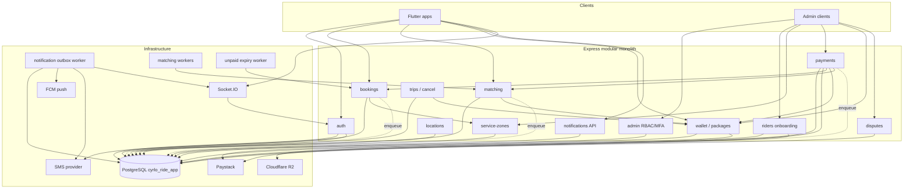

# Cyrlo Ride — Milestone 11: Integration & Production Readiness Audit

**Date:** 2026-11-07  
**Scope:** Backend hardening after Milestones 1–10. Read-only verification against `CYRLO_RIDE_MASTER_SPEC.md`, then narrowly scoped critical fixes.  
**Authoritative source:** `docs/architecture/CYRLO_RIDE_MASTER_SPEC.md` (not completion reports alone).  
**Database under audit:** `cyrlo_ride_app` only. Legacy `cyrlo_ride` was not modified.

---

## 1. Architecture dependency map

**Module interaction summary**

| Module | Depends on | Side effects |
| --- | --- | --- |
| auth | SMS, JWT secrets, OTP rate limits | refresh-token families |
| admin | MFA encryption, RBAC grants | audit log |
| riders | R2, identity encryption | document objects, Ghana Card ciphertext |
| service-zones | PostGIS/polygon containment | rider-zone approvals |
| locations | GPS freshness rules | availability gating for matching |
| bookings | zones, payments constants | fee payment row, search timers |
| payments | Paystack, bookings, wallet, matching | webhook events, refunds, SEARCHING + dispatch |
| matching | locations, wallet debit | offers, single-winner accept |
| trips/cancel | `decideRefunds`, wallet reverse | token reverse once, fee refund queue |
| disputes | bookings | support workflows; no invented refund override |
| wallet | Paystack via payments webhook | immutable ledger, package snapshots |
| notifications | outbox worker | push / SMS / in-app / socket fan-out |

Workers today start **inside** `createApp()` when `NODE_ENV !== 'test'` (`app.ts`). Job modules exist under `backend/src/jobs/` but there is no separate process entrypoint.

---

## 2. End-to-end workflow verification

### 2.1 Passenger journey

| # | Step | Result | Evidence |
| --- | --- | --- | --- |
| 1 | Register / authenticate | **Pass** | Auth OTP + refresh sessions (M1) |
| 2 | Create booking | **Pass** | `bookings` create; fee fixed at 100 pesewas |
| 3 | Pickup vs active service zone | **Pass** | Zone containment on create; fails closed without zone |
| 4 | Initialize GH₵1 fee | **Pass** | `BOOKING_FEE_PESEWAS = 100`; Paystack initialize |
| 5 | Paystack confirms payment | **Pass** (after fix) | Webhook signature + event row; crash recovery re-applies when `processedAt` null |
| 6 | Booking → `SEARCHING` | **Pass** | On-time success only |
| 7 | Matching dispatches offers | **Pass** (config-gated) | Requires `RIDER_OFFER_RESPONSE_TIMEOUT_SECONDS` |
| 8 | Eligible rider accepts | **Pass** | Locked accept; first valid wins |
| 9 | Exactly one token deducted | **Pass** | DB tests; unique debit idempotency |
| 10 | Competing offers invalidated | **Pass** | Same accept transaction |
| 11 | Rider starts trip | **Pass** | `ACCEPTED → IN_PROGRESS` |
| 12 | Rider completes trip | **Pass** | `IN_PROGRESS → COMPLETED` |
| 13 | Notifications | **Partial** | Outbox + in-app enqueue present; production SMS/push need config; Socket booking rooms now joinable via `booking:subscribe` |

No fabricated rules were added for missing product decisions (offer ranking, passenger post-accept fee refund criteria).

### 2.2 Rider journey

| # | Step | Result | Evidence |
| --- | --- | --- | --- |
| 1 | Register | **Pass** | Auth role RIDER |
| 2 | Completes onboarding | **Pass** | Rider profile flow (M3) |
| 3 | Submits documents | **Pass** | R2 private objects + signed URLs |
| 4 | Ops reviews / approves rider | **Pass** | Admin ops routes + MFA on sensitive paths |
| 5 | Vehicle approval | **Pass** | Vehicle review workflow |
| 6 | Service-zone approval | **Pass** | Rider–zone approval |
| 7 | Updates location | **Pass** | Location module + freshness |
| 8 | Goes online | **Pass** | Availability state machine |
| 9 | Purchases tokens | **Pass** | Package snapshot + webhook credit |
| 10 | Receives / responds to offers | **Pass** (timeout env required) | Matching offers |
| 11 | Completes trips | **Pass** | Trip module |
| 12 | Wallet + notification history consistent | **Pass** with caveats | Ledger immutable; outbox retries; SMS/push optional until configured |

---

## 3. Financial integrity findings

| Invariant | Status | Notes |
| --- | --- | --- |
| Booking fee always 100 pesewas | **Pass** | `constants.ts` + initiation rejects mismatched amounts |
| No fare collection | **Pass** | No fare payment purpose in booking fee path; disputes may categorize “fare” as a dispute topic only |
| Payment references unique | **Pass** | `payments.provider_reference` unique |
| Webhook processing idempotent | **Pass after fix** | Duplicate delivery no-ops when `processedAt` set; **re-applies** when row exists but unprocessed |
| Late success does not revive expired booking | **Pass after race fix** | Marks failed / queues refund `late_payment_after_deadline`; lost SEARCHING race now also refunds |
| Fee refunds are compensating | **Pass** | `payment_refunds` rows; status tracks provider progress |
| Matching accept deducts exactly one token | **Pass** | Concurrent accept DB test |
| Rider cancel reverses original debit once | **Pass** | `decideRefunds` + unique reverse idempotency |
| Token purchase credits snapshot quantity | **Pass** | Snapshot on `token_purchases` |
| Duplicate payment events cannot double-credit | **Pass** | Webhook event unique + ledger idempotency keys |
| No unauthorized negative balances | **Pass** | CHECK `token_balance >= 0`, `balance_after >= 0` |
| Original payment / ledger immutable | **Pass** | Append-only ledger pattern |

**Deprecated helpers:** `shouldRefundBookingFee` / `shouldRefundToken` in `booking-rules.ts` are **not** called by production services (only `tests/domain.test.ts`). They disagree with approved `decideRefunds` (notably rider-cancel token refund). **Not deleted** (per milestone rule). Prefer `decideRefunds` only.

**Critical / high defects fixed in this milestone:**

1. Paystack webhook `P2002` early-return without `processedAt` check.  
2. On-time webhook returned early when `markSearchingAfterFeeSuccess` lost to unpaid expiry.  
3. Webhook replay when payment already `SUCCESS` skipped booking-fee effect (stranded `AWAITING_PAYMENT` + captured fee) — now re-applies SEARCHING or refund ([Integration dump](13a207a7-b8e5-4085-87e1-eb622f085fce) **H-1**).  
4. `executeRefund` conditional claim before Paystack.  
5. OTP attempt increments and refresh-family revocation no longer roll back when AppError is thrown ([Integration dump](13a207a7-b8e5-4085-87e1-eb622f085fce) **H-2** / **H-3**).  
6. `transitionBooking` / `completeTrip` use `FOR UPDATE` + conditional `updateMany` (**H-4**).

Also confirmed by [Architecture E2E](44adbd9c-71aa-4655-aeff-25cd6ddd8c31), [Financial integrity](331d1c64-ff83-4dca-ae21-f961408ddadb), [Security](fc663cbc-ff56-4f3a-b56f-e839cb7979bd).

---

## 4. Concurrency findings

| Race | Protection | Status |
| --- | --- | --- |
| Two riders accept one booking | `SELECT … FOR UPDATE` on booking + offer; unique winner | Covered by DB test |
| One rider two bookings | Eligibility + active-trip check; wallet debit constraints | Covered |
| Search expiry vs accept | Status + expiry checks inside accept TX | Covered |
| Payment webhook vs unpaid timeout | Late success → refund, no SEARCHING | Covered |
| Duplicate Paystack webhook | Unique `provider_event_id` + `processedAt` gate | Covered (incl. crash recovery) |
| Duplicate refund execution | Unique refund / ledger keys | Covered |
| Rider cancel + token reverse | Idempotent reverse key | Covered |
| Concurrent token purchase webhooks | Unique event + fulfill idempotency | Covered |
| Multiple notification workers | Claim SQL with `lockedBy` / status | Covered by outbox DB tests |
| Worker crash mid-process | Stale `PROCESSING` reclaim window | Covered |
| Retry after provider failure | Outbox attempts + backoff | Covered |

Workers share the API process; horizontal multi-instance claim logic exists for outbox, but matching/unpaid workers are simple intervals (safe if single writer; document multi-instance caution).

---

## 5. Security findings

| Area | Status | Notes |
| --- | --- | --- |
| Passenger ownership | **Pass** | Own booking/not-found pattern |
| Rider ownership | **Pass** | Offer/trip ownership checks |
| Admin permission enforcement | **Pass** | RBAC middleware |
| MFA on sensitive actions | **Pass** | Recent MFA window |
| OTP rate limits / replay | **Pass** | Cooldown, max attempts, hashed OTP |
| Refresh token family revocation | **Pass** | Family revoke on reuse |
| Device-token ownership | **Pass** | Unique `(userId, token)` |
| Socket.IO room authorization | **Pass after fix** | Auto user room; `booking:subscribe` checks passenger/assigned rider |
| R2 private object access | **Pass** | Fail closed when unset; signed URLs |
| Signed URL expiration | **Pass** | `R2_SIGNED_URL_TTL_SECONDS` |
| Ghana Card encryption + audit | **Pass** | Separate AES key; access audited |
| Secrets in logs | **Mostly pass** | pino redaction baseline; continue reviewing custom metadata |
| Secrets not in source control | **Pass** | `.env` gitignored; `.env.example` placeholders only |
| Webhook signature verification | **Pass** | HMAC SHA-512 |
| API rate limiting | **Pass** | Global + OTP limits |
| Input validation / error leakage | **Pass** | Zod + `AppError` codes |

No destructive penetration testing was performed against production.

---

## 6. Production infrastructure checklist (summary)

See also `PRODUCTION_DEPLOYMENT_CHECKLIST.md`.

| Item | Status |
| --- | --- |
| PostgreSQL `cyrlo_ride_app` | Required; migrations apply forward |
| Paystack keys | Required in production boot (after this audit) |
| Cloudflare R2 | Required for document upload/download |
| `IDENTITY_ENCRYPTION_KEY` | Required; 32-byte base64; ≠ MFA key |
| `ADMIN_MFA_ENCRYPTION_KEY` | Required; 32-byte base64 |
| FCM / APNs | Optional until push enabled; named unsupported vendors fail closed |
| SMS | Production without provider+key fails closed on send; **named vendor adapters still absent** |
| Maps API | Stub / NOT_IMPLEMENTED for server geocode; Flutter uses pinned Cyrlo Maps commit |
| Socket.IO | Shares HTTP server; auth via access token |
| Background workers | In-process today; crash recovery via DB state |
| Health vs readiness | `/health` liveness; `/health/ready` DB ping |
| Backups | `backend/scripts/backup-postgres.sh` documented; restore procedure in checklist |
| Fail closed on missing secrets | JWT/OTP placeholders rejected in production; Paystack + offer timeout now required |

**Out of scope this milestone:** VPS, Nginx, DNS, hosted websites.

---

## 7. Unresolved decision register

| Decision | Classification | Notes |
| --- | --- | --- |
| `RIDER_OFFER_RESPONSE_TIMEOUT_SECONDS` | **Requires product-owner decision** + **Requires configuration** + **Production blocker** until set | No code default; production boot now refuses empty value |
| Candidate ordering when >3 riders in 5 km | **Requires product-owner decision** | Code uses injectable stable `riderId` ordering — not an approved preference |
| Passenger cancel after acceptance — fee refund criteria | **Requires product-owner decision** | Spec: no automatic refund; finance review criteria open |
| Dispute override of no-refund-after-completion | **Requires product-owner decision** | Disputes do not invent refunds |
| Monetary approval thresholds | **Requires product-owner decision** | Finance tooling present without threshold policy |
| Token-purchase refund policy | **Requires product-owner decision** | Purchase path has no approved automatic refund |
| Pilot service-zone polygons | **Requires external infrastructure** / ops input | Atwima Kwanwoma pilot named; polygons not invented in repo |
| SMS production configuration | **Requires configuration** + **Requires external infrastructure** | Credentials alone do not enable a live named vendor adapter |
| R2 production configuration | **Requires configuration** | Fail closed when empty |
| MFA method | **Resolved** (in implementation) | TOTP + encrypted secrets (M2). Master/OPEN_DECISIONS text still lists “MFA method” as open — documentation lag |
| Object-storage vendor | **Resolved** (in implementation) | Cloudflare R2. Docs lag |
| Suspension during `ON_TRIP` | **Requires product-owner decision** | |
| Offline while `OFFER_PENDING` | **Requires product-owner decision** | |
| Critical SMS set beyond OTP | **Requires product-owner decision** | |
| Trip GPS retention after 24h | **Requires product-owner decision** | |
| Identity key manager / retention | **Requires product-owner decision** | |
| Vehicle checklist beyond photos / capacity | **Requires product-owner decision** | |

---

## 8. Findings by severity

### Critical

1. **Paystack webhook crash recovery gap (fixed)** — `P2002` early return skipped unprocessed events.  
2. **On-time SUCCESS vs unpaid-expiry race (fixed)** — `markSearchingAfterFeeSuccess` null still returned without refund.  
3. **SUCCESS-but-not-SEARCHING stranded fee (fixed)** — Replay now finalizes booking fee effect.  
   - File: `backend/src/modules/payments/module.service.ts`  
   - Regression: `backend/src/modules/bookings/module.db.test.ts`

### High

4. **`RIDER_OFFER_RESPONSE_TIMEOUT_SECONDS` unset blocks matching** — Fail-closed by design.  
5. **SMS named vendor not implemented (C-2)** — Production OTP cannot send; credentials alone still yield `UnconfiguredSmsProvider`.  
6. **No independent worker processes**.  
7. **Concurrent `executeRefund` double-call (fixed)**; refund webhook reconciliation / stuck `PROCESSING` still open (**H-7** remainder).  
8. **OTP attempt counter / refresh reuse revoke rolled back (fixed)** — Prisma TX no longer throws after side-effects.  
9. **Unguarded `transitionBooking` / `completeTrip` (fixed)** — row lock + conditional update.  
10. **`ABANDONED → SUCCESS` still allowed for late capture**.  
11. **Missing FK `token_ledger_entries.payment_id` → `payments`**.  
12. **Admin suspend/reinstate not mounted**.  
13. **Passenger acknowledgement API absent**.  
14. **Ghana Card decrypt not scoped to open identity-review case**.  
15. **Fee-refund queue not atomic with status change; no sweeper (H-6)**.  
16. **`TRUST_PROXY` default false + global rate limit can starve webhook/OTP behind reverse proxy (H-5)**.  
17. **FCM legacy HTTP endpoint (H-8)** — verify / migrate to HTTP v1.

### Medium

12. **Socket booking rooms previously lacked authorized client join (fixed)**.  
13. **Production env previously allowed empty Paystack secret (hardened)**.  
14. **Deprecated refund helpers disagree with approved policy** — Tests only; retained.  
15. **`.env.example` DB name (fixed)**.  
16. **Multi-instance matching workers** — Prefer single matching writer.  
17. **OPEN_DECISIONS / master §18 lag** — MFA/R2 resolved in code.  
18. **Dispute `REFUND_FEE` on `COMPLETED` can queue money** — Matrix says no refund after completion; override criteria unresolved but code can queue.  
19. **Fee-refund retry attempt-numbered keys unused** — Always `booking-fee-refund:{paymentId}`.  
20. **Dual wallet mutation ownership** — Matching/bookings use `WalletRepository` directly; purchases use `WalletService`.  
21. **Stored `BUSY` vs derived availability model** — Spec prefers derived display; accept sets `BUSY`; go-online can clear while trip active.  
22. **Offline during pending offer allowed** — Product unresolved; code does not retire offers.  
23. **Dispute non-party returns 403 not 404** — Booking-id probing.  
24. **Non-`access` JWT purpose accepted by general `authenticate`** — MFA-pending tokens may hit non-admin routes.  
25. **Webhook shares global API rate bucket** — Retries can contend with client traffic.  
26. **Flutter ↔ API disconnect** — Hardcoded OTP, stale vehicle kinds, missing matching paths (client milestone).

### Low

27. Maps server stub; push empty/fail-closed; backup dump filename cosmetic.  
28. No unique HMAC on Ghana Card for cross-rider duplicate detection.  
29. Trip GPS retention constant without cleanup job.  
30. Repository accepts `bookingFeePesewas` input while payment forces 100 (latent divergence).

---

## 9. Exact files requiring changes

### Changed in this milestone (fixes)

| File | Change |
| --- | --- |
| `backend/src/modules/payments/module.service.ts` | Webhook reprocess; SEARCHING-race; SUCCESS replay finalize; refund claim |
| `backend/src/modules/bookings/module.db.test.ts` | Crash / race / stranded-SUCCESS regressions |
| `backend/src/modules/bookings/module.repository.ts` | `transitionBooking` FOR UPDATE + conditional update |
| `backend/src/modules/bookings/module.service.ts` | `completeTrip` guarded write |
| `backend/src/modules/auth/module.repository.ts` | Persist OTP attempts + refresh-family revoke |
| `backend/src/modules/auth/module.db.test.ts` | Auth side-effect DB regressions |
| `backend/src/config/env.ts` | Production requires Paystack secret + offer timeout |
| `backend/src/infrastructure/realtime/socket.ts` | Authorized `booking:subscribe` / unsubscribe |
| `backend/src/server.ts` | Pass `prisma` into realtime server |
| `backend/.env.example` | Correct DB name; document matching/notification env |

### Recommended follow-ups (not auto-refactored)

| File / area | Why |
| --- | --- |
| `backend/src/infrastructure/sms/sms.provider.ts` | Real vendor adapter after product chooses SMS |
| Payment timeout vs `ABANDONED` | Align late capture with approved payment transitions |
| `token_ledger_entries.payment_id` FK migration | Spec compliance |
| Admin suspend/reinstate | Spec requires audited suspend |
| Passenger acknowledge route | Spec gap |
| Ghana Card reveal case gate | Identity-review scoping |
| `backend/src/jobs/*` + CLI entrypoints | Separate worker processes |
| `docs/architecture/OPEN_DECISIONS.md` | Mark MFA/R2 resolved; keep true opens |
| Matching ordering / availability derived model | After product decisions |
| Dispute COMPLETED refund gate; 403→404 | Policy + ownership probing |

---

## 10. Recommended remediation order

1. **Done:** Webhook crash recovery; SEARCHING-race refund; refund claim; socket subscribe; prod Paystack/timeout env.  
2. Product owner: set `RIDER_OFFER_RESPONSE_TIMEOUT_SECONDS`.  
3. Engineering + product: SMS vendor adapter (OTP blocker).  
4. Finance/product: resolve `ABANDONED` vs late SUCCESS; add ledger `payment_id` FK.  
5. Ops: R2, Paystack live keys, identity/MFA keys, Postgres backups.  
6. Engineering: admin suspend/reinstate; passenger acknowledge; Ghana Card case gate.  
7. Product: candidate ordering; post-accept refund criteria; dispute override; offline-during-offer.  
8. Engineering: separate workers; dispute 404 ownership; `authenticate` purpose gate.  
9. Load pilot polygons; seed packages; bootstrap Super Admin.  
10. Flutter client milestone against frozen API contract.

---

## 11. Verification results (Phase H)

Executed 2026-11-07 against local `cyrlo_ride_app`:

| Check | Result |
| --- | --- |
| `npm run typecheck` | **Pass** (`tsc --noEmit` exit 0) |
| `npm run prisma:validate` | **Pass** — schema valid |
| `npx prisma migrate status` | **Pass** — 11 migrations, database schema up to date |
| `npm test` | **Pass** — 25 files, **124/124** tests passed |
| `npm audit` | **4 high** advisories reported (see below) — not suppressed |

**npm audit (exact):**

- `deepmerge-ts` < 8.0.0 via `prisma` / `@prisma/config` — stack exhaustion on recursive merges (GHSA-ggr8-5vv4-36mx). Fix path wants Prisma 7 (breaking).  
- `zod` < 4.6.6 — memory exhaustion on oversized constrained collections (GHSA-mrhx-c7xc-m3w5). Fix path wants Zod 4 (breaking).

Do not force-upgrade Prisma/Zod in this hardening milestone without a dedicated upgrade plan. Track as dependency risk for pilot prep.
---

## 12. Flutter integration readiness

**Conditionally ready** for Flutter integration against the API contract, provided:

- Local/staging Postgres migrations applied  
- Paystack test keys + webhook URL  
- Offer timeout configured  
- R2 configured for rider docs (if onboarding tested)  
- SMS strategy agreed for OTP in non-dev environments  

**Not ready for a real public pilot** until open decisions above (timeout, polygons, SMS, ranking) are resolved and production secrets/providers are live.

---

## 13. Fixes vs findings

| Item | Finding only | Fixed in M11 |
| --- | --- | --- |
| Webhook unprocessed replay | | Yes |
| SEARCHING vs unpaid-expiry race | | Yes |
| SUCCESS-without-SEARCHING replay | | Yes |
| Concurrent refund double-fire | | Yes |
| OTP attempt / refresh revoke TX rollback | | Yes |
| Unguarded booking transitions | | Yes |
| Socket booking room auth | | Yes |
| Production Paystack/timeout env | | Yes |
| `.env.example` DB name | | Yes |
| SMS vendor missing | Yes | |
| Refund sweeper / refund webhooks | | **Phase 11A** |
| Abandoned token late SUCCESS → Finance case | | **Phase 11A** |
| Ledger `payment_id` FK | Yes | |
| Admin suspend / passenger ack | Yes | |
| TRUST_PROXY / FCM v1 | Yes | |
| Offer timeout / ranking / workers | Yes | |
| Deprecated refund helpers | Yes (retained) | |
